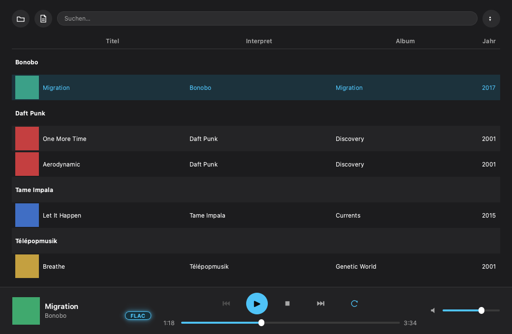

# FloPlayer

Minimalistischer Desktop-Musikplayer mit PySide6 (Qt 6) im Stil von Apple Music/Spotify. Fokus auf FLAC-Bibliotheken, liest aber auch MP3, OGG, WAV, M4A und AAC.



## Features

- Bibliotheksordner einlesen, inkl. Tags und Cover (über `mutagen`)
- Gruppieren/Sortieren nach Interpret, Album, Jahr oder Titel
- Live-Suche über Titel, Interpret und Album
- Qualitäts-Badge in der Playerleiste (leuchtendes "FLAC"-Badge bzw. MP3-Bitrate)
- Wiederholen: aus / ganze Bibliothek / aktueller Titel
- Merkt sich die zuletzt geöffnete Bibliothek

## Einrichtung

```bash
python -m venv .venv

# Windows:
.venv\Scripts\activate
# macOS/Linux:
source .venv/bin/activate

pip install -r requirements.txt
```

## Starten

```bash
python main.py
```

## Lizenz

GPL-3.0 (siehe [LICENSE.md](LICENSE.md)) — bedingt durch die Verwendung von [`mutagen`](https://github.com/quodlibet/mutagen) (GPL-2.0-or-later) und [`PySide6`](https://pyside.org) (LGPL-3.0/GPL).
